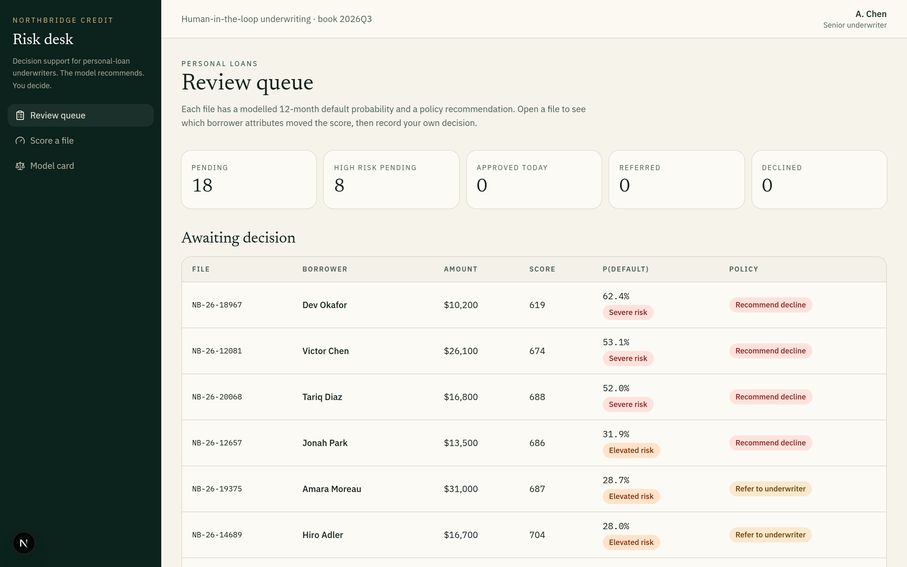
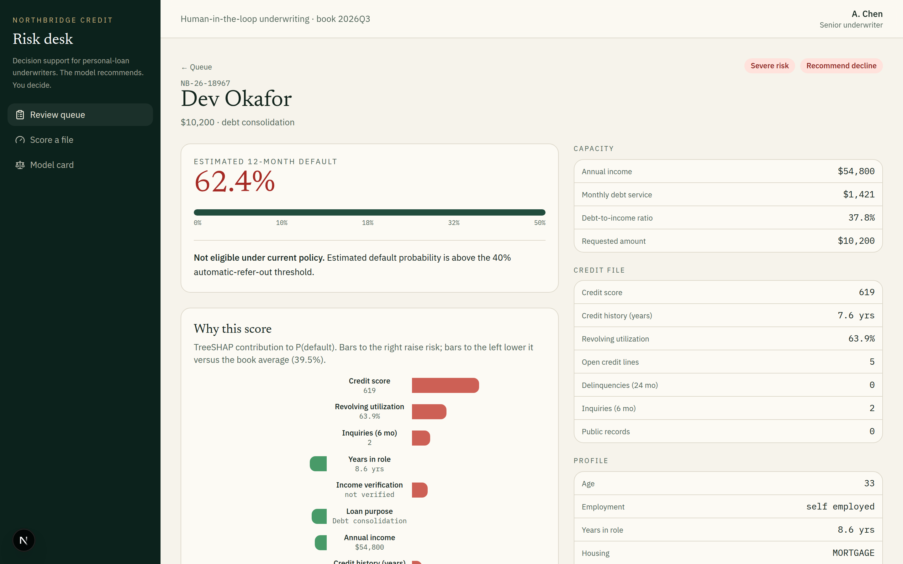
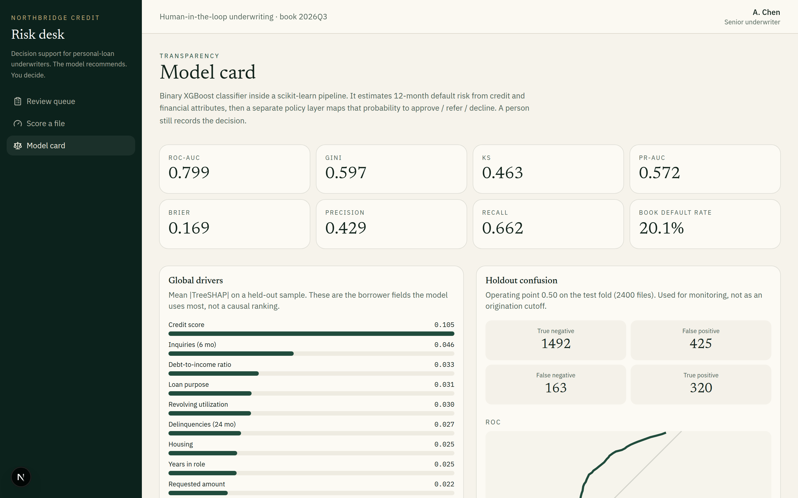

# AI Credit Risk & Loan Decision Support System


Python · scikit-learn · XGBoost · Explainable AI (TreeSHAP) · MIT License

A **decision-support** workbench for personal-loan underwriters. An XGBoost classifier estimates 12-month default risk from credit history and financial attributes. TreeSHAP surfaces the borrower features that moved the score. A separate policy layer maps that probability onto approve / refer / decline. **A person still records the decision.**

This is not an automated origination engine.




## What it does

- **Binary classification pipeline** — scikit-learn `ColumnTransformer` + `XGBClassifier` on tabular borrower attributes (income, DTI, credit score, utilization, delinquencies, housing, purpose, and related fields).
- **Default risk & eligibility** — the model outputs P(default); policy rules turn that into a recommendation the underwriter can override.
- **Feature transparency** — interventional TreeSHAP in probability units, rolled back from one-hot columns to original fields so a reviewer can see *why* a file scored the way it did.
- **Human in the loop** — the Risk Desk queue lets an underwriter open a file, read the drivers, and approve, refer, or decline with a written rationale.

### Why a file scored the way it did



Each contribution is expressed in probability units against the book average, and one-hot columns are rolled back to the original field, so "income verification: not verified" appears as one driver rather than scattered across encoded columns. The policy gate that produced the recommendation is stated in plain language above it.

The training book is **fully synthetic**. No real consumer records are used.

## Reproducible holdout results

The committed model was evaluated on 2,400 synthetic records held out before training.

| Metric | Result |
| --- | ---: |
| ROC-AUC | 0.7987 |
| PR-AUC | 0.5722 |
| F1 at 0.50 threshold | 0.5212 |
| Recall | 0.6625 |
| Precision | 0.4295 |
| Brier score | 0.1691 |

These results measure how well the model recovers patterns from the same synthetic data-generating process. They are not evidence of performance on real applicants. `artifacts/metrics.json` contains the full confusion matrix, ROC points, and subgroup diagnostics.

## Architecture

```
credit_risk/          data generation, sklearn pipeline, SHAP, policy overlay
api/                  FastAPI: queue, scoring, explanations, decisions
scripts/train.py      fit the model and write artifacts/
scripts/explain_sample.py
web/                  Next.js underwriter workbench
artifacts/            generated model files plus committed evaluation metadata
```

## Run locally

Python 3.11+ and Node 20+ .

```bash
python -m venv .venv
source .venv/bin/activate   # Windows: .venv\Scripts\activate
pip install -r requirements.txt
export PYTHONPATH=.
python scripts/train.py     # writes generated model files under artifacts/

python -m uvicorn api.main:app --host 0.0.0.0 --port 45232
```

In another terminal:

```bash
cd web
npm install
npm run dev
```

Open [http://localhost:45231](http://localhost:45231). The UI proxies `/backend/*` to the API.

```bash
pytest
python scripts/explain_sample.py
```

## Model notes




| Item | Detail |
| --- | --- |
| Task | 12-month default (binary) |
| Algorithm | XGBoost (`hist`) in a scikit-learn pipeline |
| Categorical handling | One-hot inside `ColumnTransformer` |
| Explainability | `shap.TreeExplainer`, interventional, probability output |
| Policy overlay | Score + credit-score + DTI gates → approve / refer / decline |
| Decisioning | Human underwriter; model never books a loan |
| Protected attribute handling | Age is excluded from model inputs and retained only for subgroup auditing |

The repository keeps the small evaluation and model-card JSON files. The fitted model, SHAP background, and sample review queue are generated locally by `python scripts/train.py` and are intentionally not versioned. The API also trains them automatically if `artifacts/model.joblib` is missing. Retrain after changing the data generator or hyperparameters.

## Limitations

- The dataset is synthetic and does not represent a real lender's population or approval policy.
- The holdout set comes from the same generator as the training set. External validity is unknown.
- Group diagnostics cover age bands and employment status only because the synthetic data does not contain race, ethnicity, sex, disability, or other protected attributes.
- SHAP values explain the fitted model, not whether a recommendation is lawful, fair, or correct.
- The fixed 0.50 threshold is a demonstration setting, not a production decision threshold.
- The demo has no identity verification, audit-log storage, model monitoring, or production security controls.

## Why decision support

Credit files need an accountable reviewer. The desk is built so the model is evidence — a probability, a policy band, and the features that mattered — not a silent yes/no. That matches how a model-risk and fair-lending process actually uses machine learning: as an input to a documented human decision.
